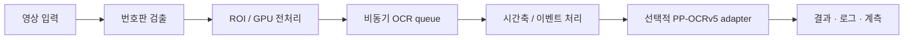
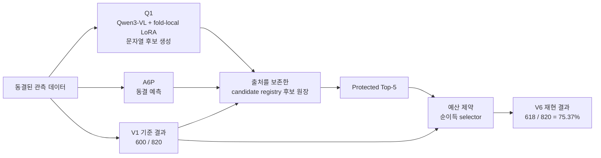

# 소프트웨어 · 시스템 개발 포트폴리오

### Software & System Portfolio

**실제 입력 환경의 영상처리 파이프라인 · 성능 병목 계측 · 재현 가능한 연구 검증**

실제 CCTV 입력을 처리하는 영상처리 시스템과 그 위에서 별도로 수행한 정확도 개선 연구를 파이프라인·실험 계보·재현 근거 단위로 정리했습니다. 단순히 정확도만 제시하지 않고 결과의 입력과 기준, 개선과 회귀, 실제 실행 코드와 연구 실험의 경계를 함께 기록했습니다.

## 현재 재현 기준 V6 결과

**618 / 820 = 75.37%**

- 직접 비교 기준 V1: `600 / 820 = 73.17%`
- 변경 출력: `65개`
- 오답 → 정답: `25개`
- 정답 → 오답: `7개`
- 오답 → 다른 오답: `33개`
- 순개선: **+18개**

> 이 결과는 **회고적 GT0 Nested Outer-5 개발 평가** 결과입니다. blind / unseen / external benchmark / production 정확도 / 공식 대회 성능을 의미하지 않습니다.

V6의 최종 prediction과 config는 평가 전에 동결했지만, 동일 GT0가 이전 연구 과정에서 반복적으로 사용된 회고적 개발 benchmark입니다. 따라서 독립적인 외부 일반화 성능으로 해석하지 않습니다.

## 전체 시스템 구조

코드 관계는 [`run_detection.py`](01_CCTV_LPR_System/run_detection.py) → [`gpu_pipeline2.GPUPipeline`](01_CCTV_LPR_System/gpu_pipeline2.py) → [`gpu_pipeline.GPUPipeline`](01_CCTV_LPR_System/gpu_pipeline.py)입니다. `gpu_pipeline.py`와 `gpu_pipeline2.py`는 서로 다른 프로젝트가 아니라 하나의 CCTV 번호판 처리 시스템을 구성하는 기반 구현과 확장 계층입니다.

### 실행 성능 분석 사례

특정 실행 계측에서 OCR OFF `22.94 fps`, OCR ON `1.04 fps`가 측정되었습니다. 처리 단계를 분리해 확인한 결과 주요 병목은 detector 자체보다 OCR-trigger 이후의 CPU crop / rectification 및 저배치 queue 경로에 있었습니다. 이는 특정 계측 사례이며 현재 시스템 전체의 일반적인 FPS를 뜻하지 않습니다.

## 최신 V6 연구 구조

Q1은 Qwen3-VL + fold-local LoRA로 문자열 후보를 생성합니다. Qwen3-VL은 V6 전체의 최종 판정 모델이 아니라 추가 문자열 후보를 제공하는 candidate source입니다. 최종 75.37%는 여러 후보 출처와 V1 parent를 결합한 V6 선택 계보의 결과입니다.

## 프로젝트 구성

| 구분 | 내용 | 상태 |
|---|---|---|
| [`01_CCTV_LPR_System`](01_CCTV_LPR_System/) | CCTV 입력 → 검출 → GPU 전처리 → 비동기 OCR → 시간축/이벤트 처리 | 메인 시스템 코드 |
| [`02_T2_Accuracy_Research`](02_T2_Accuracy_Research/) | 과거 T2 cross-fit selector 정확도 연구 | 이전 연구 계보 |
| [`03_CSharp_ImageProcessing`](03_CSharp_ImageProcessing/) | WinForms 기반 퍼지 이진화 및 FAM 영상 복원 | 학부 보조 프로젝트 |
| [`04_V6_75p37_Latest_Audit`](04_V6_75p37_Latest_Audit/) | Q1·A6P·V1 후보 출처 보존 및 V6 선택 과정 | 현재 재현 기준 연구 |

## 정확도 연구 계보

| 단계 | Exact Top-1 | 의미 |
|---|---:|---|
| T2 | `541/820 = 65.98%` | 별도 이전 연구 계보 |
| V1 | `600/820 = 73.17%` | 현재 V6의 직접 비교 기준 |
| **V6 재현 기준** | **`618/820 = 75.37%`** | **현재 포트폴리오 대표 결과** |

별도로 동결된 과거 snapshot

- 2026-10-08 별도 Core-Light frozen snapshot: `622/820 = 75.85%`
- 이는 `PARTIAL_REPRODUCTION` 상태의 별도 과거 authority이며 현재 재현 기준 headline이 아닙니다.

## 개발 과정에서 중요하게 본 것

1. 최적화 전에 CPU/GPU 처리시간, queue, batch, OCR trigger 경로를 구간별로 측정했습니다.
2. 후보 문자열이 어느 model·view·parent에서 발생했는지 삭제하지 않고 보존했습니다.
3. 전체 정확도뿐 아니라 `W→C`와 `C→W`를 함께 계산했습니다.
4. 새 방법의 근거가 충분하지 않으면 기존 parent 결과를 유지했습니다.
5. prediction, config, SHA256, 평가 결과를 분리해 동결했습니다.

## 핵심 기술

Python, C#, PyTorch/CUDA, OpenCV, ONNX Runtime, Ultralytics, EasyOCR, PaddleOCR, NumPy, scikit-learn, LightGBM, Transformers, PEFT, Accelerate를 사용했습니다.

## 재현 범위

이 저장소는 원본 CCTV 데이터와 대형 model weight를 포함하지 않습니다. V6 재현은 동결된 candidate/prediction/config 이후의 최종 선택 및 평가 경로를 대상으로 합니다. 원자료에서 Qwen LoRA를 다시 학습해 동일 checkpoint를 만드는 완전한 training-from-scratch 재현과는 구분합니다.

자세한 구조와 경계는 [전체 아키텍처](docs/ARCHITECTURE.md), [재현 설명](04_V6_75p37_Latest_Audit/REPRODUCTION_NOTES.md), [주장 범위](04_V6_75p37_Latest_Audit/CLAIM_BOUNDARY.md), [지표 authority](04_V6_75p37_Latest_Audit/METRIC_AUTHORITY.json)에 기록했습니다.

## 참고문헌 · 출처 · 라이선스

이 포트폴리오는 직접 구현한 코드뿐 아니라 외부 오픈소스 라이브러리와 공개 연구에서 영향을 받은 실험을 포함합니다. 본인 구현과 외부 의존성의 경계는 다음 문서에 별도로 기록했습니다.

- [연구 참고문헌](REFERENCES.md)
- [외부 소프트웨어 및 라이선스](THIRD_PARTY_NOTICES.md)
- [소스 출처 및 구현 경계](SOURCE_PROVENANCE.md)
- [이미지 및 자료 출처](ASSET_SOURCES.md)
- [포트폴리오 표현 요소 출처](docs/PORTFOLIO_STYLE_SOURCES.md)

확인되지 않은 출처는 임의로 추정하지 않고 `NEEDS_SOURCE_CONFIRMATION` 상태로 유지합니다.
