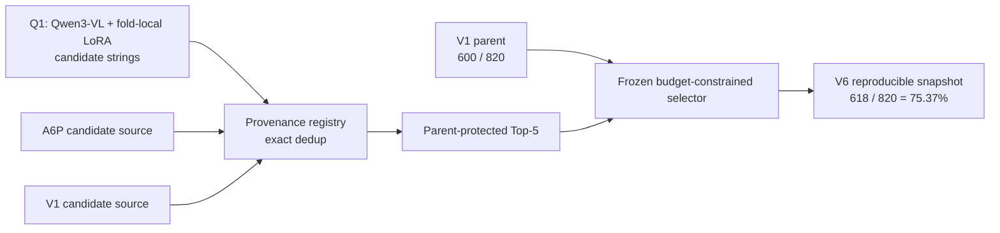

# CCTV LPR Engineering & Research Portfolio

<div align="center">


</div>

## Reproducible V6 Snapshot

**618 / 820 = 75.37%**

V1 parent: `600 / 820 = 73.17%`

`65` switches · `W→C 25` · `C→W 7` · `W→W 33` · **Net +18**

> Retrospective GT0 Nested Outer-5 development benchmark. Frozen research replay; not blind, unseen, external, production, or competition performance.

The replay starts from frozen research artifacts and configuration. It reproduces the final decision/evaluation path; it does not claim retraining from raw CCTV data or full pixel-to-final inference.

## System Pipeline


Production-style source topology is preserved byte-for-byte:
[`run_detection.py`](01_CCTV_LPR_System/run_detection.py) → [`gpu_pipeline2.GPUPipeline`](01_CCTV_LPR_System/gpu_pipeline2.py) → inherits [`gpu_pipeline.GPUPipeline`](01_CCTV_LPR_System/gpu_pipeline.py).

Measured snapshot note: OCR OFF `22.94 fps`; OCR ON `1.04 fps`, identifying OCR as the observed runtime bottleneck for that measurement, not a general performance guarantee.

## Reproducible V6 Research Lineage



Qwen3-VL is a candidate generator/source, not the final scorer. The 75.37% value belongs to the complete frozen V6 decision lineage.

## Portfolio Map

- [Production-style CCTV LPR system](01_CCTV_LPR_System/)
- [Historical T2 accuracy research](02_T2_Accuracy_Research/) — `541/820 = 65.98%`
- [C# image-processing coursework](03_CSharp_ImageProcessing/)
- [Reproducible V6 audit snapshot](04_V6_75p37_Latest_Audit/)
- [Architecture](docs/ARCHITECTURE.md)
- [Audit](PORTFOLIO_AUDIT.md)

## Metric Lineage

The historical T2 experiment remains separate from the later V6 lineage:

```text
Production-style CCTV pipeline
├── Historical T2 research: 541/820 = 65.98%
└── Later V6 research lineage
    ├── V1 parent: 600/820 = 73.17%
    └── Reproducible V6: 618/820 = 75.37%
```

<details>
<summary>Historical frozen snapshots</summary>

- 2026-10-08 Core-Light frozen snapshot: `622/820 = 75.85%`.
- This is a separate historical `PARTIAL_REPRODUCTION` authority and is not the current reproducible portfolio headline.

</details>

## Engineering Focus

- GPU preprocessing, asynchronous OCR, queues, backpressure, and temporal grouping
- Provenance-aware candidate registries and parent-protected selection
- Freeze-before-GT evaluation, exact-once joins, SHA receipts, and fail-closed checks
- Explicit separation of production-style code, historical research, and reproducible audit evidence

## Tech Stack

Python, C#, PyTorch/CUDA, OpenCV, ONNX Runtime, Ultralytics, EasyOCR, PaddleOCR, NumPy, scikit-learn, LightGBM, Transformers, PEFT, and Accelerate. Dependencies and unresolved license/model-weight boundaries are recorded in [Third-Party Notices](THIRD_PARTY_NOTICES.md).

## Reproduction & Claim Boundary

The public audit contains summary evidence and no model weights, private datasets, CCTV frames, credentials, or raw GT. See [reproduction notes](04_V6_75p37_Latest_Audit/REPRODUCTION_NOTES.md), [claim boundary](04_V6_75p37_Latest_Audit/CLAIM_BOUNDARY.md), and [metric authority](04_V6_75p37_Latest_Audit/METRIC_AUTHORITY.json).

## References, Attribution & Licensing

- [References](REFERENCES.md)
- [Third-party notices](THIRD_PARTY_NOTICES.md)
- [Source provenance](SOURCE_PROVENANCE.md)
- [Asset sources](ASSET_SOURCES.md)
- [Portfolio style sources](docs/PORTFOLIO_STYLE_SOURCES.md)

