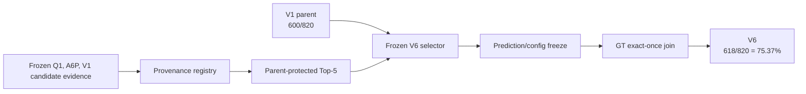

# Architecture

## Production-style pipeline

`run_detection.py` invokes `gpu_pipeline2.GPUPipeline`, which inherits `gpu_pipeline.GPUPipeline`. The source pair is preserved without modification.

## V6 audit pipeline

Q1 uses Qwen3-VL with fold-local LoRA to provide candidate strings. It is neither the final scorer nor the source of the V6 metric by itself. The public snapshot reproduces the frozen decision/evaluation path, not raw-video retraining or full pixel-to-final inference.

Scope: retrospective GT0 Nested Outer-5 development benchmark. This is not blind/unseen/external performance.
