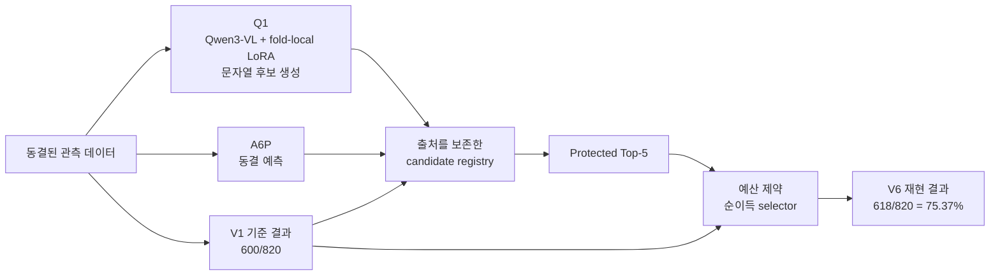

# 전체 시스템 구조

## 메인 CCTV 파이프라인

`run_detection.py`가 `gpu_pipeline2.GPUPipeline`을 호출하고, 이 클래스는 `gpu_pipeline.GPUPipeline`을 상속합니다. 두 pipeline source는 변경하지 않았습니다.

```text
영상 입력 → 번호판 검출 → ROI / GPU 전처리 → 비동기 OCR → 시간축 / 이벤트 처리 → 결과 · 로그 · 계측
```

## V6 연구 파이프라인



Q1은 Qwen3-VL + fold-local LoRA로 문자열 후보를 생성합니다. Qwen3-VL은 최종 scorer가 아니며, 75.37%는 여러 candidate source와 V1 parent를 결합한 V6 decision lineage의 결과입니다.

공개 snapshot은 동결된 최종 선택·평가 경로를 재생합니다. raw-video retraining이나 full pixel-to-final inference 재현을 의미하지 않습니다.

> 범위: 회고적 GT0 Nested Outer-5 개발 평가. blind / unseen / external benchmark 성능이 아닙니다.
